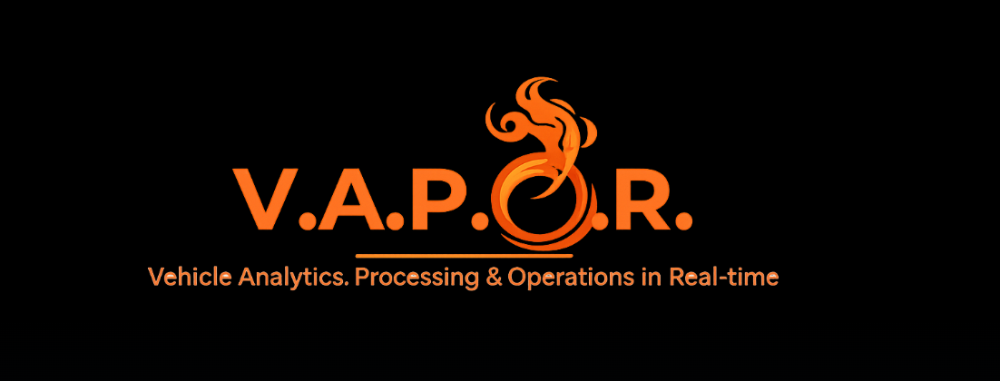
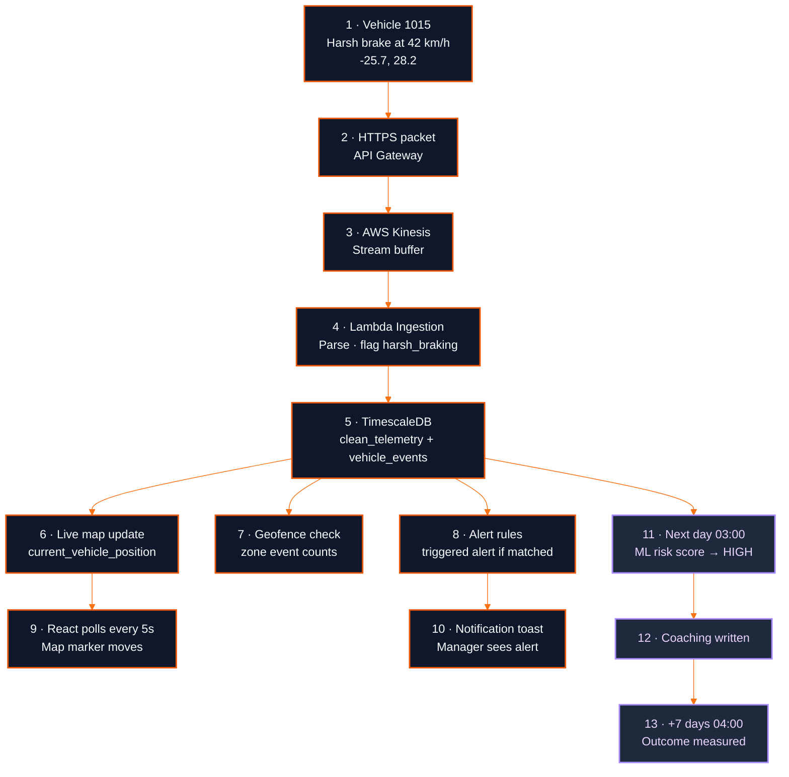
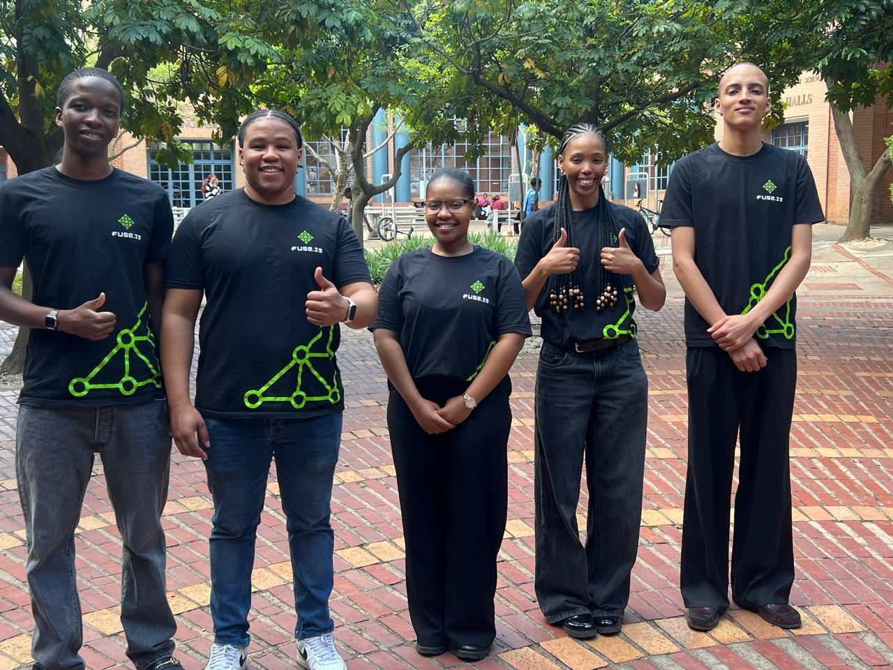

<div align="center">



<br/>


<br/><br/>

**Kilimanjaro StoneCap &nbsp;&middot;&nbsp; COS301 Capstone 2026 &nbsp;&middot;&nbsp; University of Pretoria**

<br/>

<p align="center">
  
  
  
</p>

<br/>

<a href="https://d25bouomowr0it.cloudfront.net/landing"></a>
<a href="https://github.com/COS301-SE-2026/Vehicle-Analytics-Platform/wiki"></a>
<a href="./docs/Demo4/VAPOR_User_Manual.pdf"></a>

<br/><br/>

[](https://github.com/COS301-SE-2026/Vehicle-Analytics-Platform/actions)
[](https://codecov.io/gh/COS301-SE-2026/Vehicle-Analytics-Platform)
[](https://stats.uptimerobot.com/3qOgv6HCr1)
[](https://github.com/COS301-SE-2026/Vehicle-Analytics-Platform/issues)
[](https://github.com/COS301-SE-2026/Vehicle-Analytics-Platform/issues?q=is%3Aissue+is%3Aclosed)
[](https://github.com/COS301-SE-2026/Vehicle-Analytics-Platform/commits)
[](https://nodejs.org/)
[](LICENSE)

<br/>

[](#project-description)
[](#data-flow)
[](#architecture)
[](#the-solution)
[](#use-cases)
[](#technology-stack)
[](#setup-guide)
[](#developer-guide)
[](#team-members)

</div>

---

<a id="project-description"></a>


**Kilimanjaro StoneCap - V.A.P.O.R. (Vehicle Analytics, Processing and Operations in Real-time)**

V.A.P.O.R. is a real-time fleet analytics platform built for FuseIT. It ingests live telemetry data from 100+ vehicles via AWS Kinesis, processes it through serverless Lambda functions, and delivers actionable safety insights to fleet managers through role-based dashboards while detecting speeding, harsh braking, and crash events as they happen.

---

<a id="data-flow"></a>


### The Big Picture

Data flows through five stages:

```text
1. Vehicle emits telemetry
2. Ingestion buffers it in Kinesis
3. Processing transforms and enriches it in Lambda
4. Storage persists it in TimescaleDB and S3
5. Presentation serves it to the React dashboard
```

Each stage has one job. Data moves forward. Nothing skips a stage.

### Event Journey: Harsh Braking on Vehicle 1015



<details>
<summary><b>Stage 1: Vehicle Emits Telemetry</b></summary>

<br/>

Every 5 to 10 seconds, each vehicle sends a telemetry packet. The packet contains:

* `vehicle_id` (anonymised)
* GPS coordinates (latitude, longitude)
* Speed in km/h
* Ignition state (on or off)
* Movement state (moving or stationary)
* Event flags (harsh braking, harsh acceleration, harsh cornering, crash detection)

Vehicles push this over HTTPS to the ingestion endpoint.

</details>

<details>
<summary><b>Stage 2: Ingestion Buffers It</b></summary>

<br/>

The HTTPS request hits API Gateway, which forwards the packet into AWS Kinesis Data Streams.

Kinesis is a buffer, not a database. Its job is to absorb bursts and hold records until something is ready to process them.

**Why Kinesis and not a direct database write:**

* If the database is temporarily unavailable, Kinesis retains records for 24 hours
* Multiple consumers can read the same stream
* Lambda scales independently of the write volume
* Sharding allows horizontal scaling

</details>

<details>
<summary><b>Stage 3: Processing Transforms It</b></summary>

<br/>

AWS Lambda is triggered when Kinesis has new records. The `kinesis_telemetry_ingestion` function processes a batch at a time. For each record it:

1. Parses the JSON payload
2. Validates required fields (GPS, speed, timestamp, vehicle_id)
3. Enriches it with geospatial data and road type
4. Detects unsafe driving events (speeding, harsh braking, crash)
5. Detects geofence boundary crossings against defined zones
6. Writes the record and derived events to TimescaleDB
7. On failure, sends the record to an SQS Dead Letter Queue so nothing is lost

Lambda auto scales from zero to hundreds of concurrent executions based on stream volume. No server to manage.

</details>

<details>
<summary><b>Stage 4: Storage Persists It</b></summary>

<br/>

Everything goes into PostgreSQL with TimescaleDB. Data is organised into three logical layers, following the Medallion architecture:

**Bronze (raw):**

* `raw_telemetry` - untouched incoming records, kept for debugging and replay

**Silver (cleaned):**

* `clean_telemetry` - validated records with parsed GPS and normalised speed
* `vehicle_events` - extracted events (harsh braking, speeding, crash)
* `trips` - trip boundaries and summaries

**Gold (pre-computed):**

* `current_vehicle_position` - one row per vehicle for the live map
* `driver_daily_safety_scores` - daily aggregates per vehicle
* `vehicle_risk_predictions` - ML risk scores
* `coaching_interventions` - coaching recommendations and outcomes
* `vehicle_risk_features` - feature view for the ML model

TimescaleDB hypertables partition data by time automatically. A query over the last 7 days only scans 7 days of chunks, not the full history.

Continuous aggregates pre-compute daily and weekly summaries in the background, so dashboard queries hit pre-computed rows instead of running heavy joins live.

Raw copies also go to Amazon S3 for archival and disaster recovery.

</details>

<details>
<summary><b>Stage 5: Presentation Serves It</b></summary>

<br/>

API Gateway fronts a second Lambda (`capstone-analytics-backend`) that runs an Express app through `serverless-http`. It exposes REST endpoints under `/api`.

Every request goes through:

1. Cognito JWT validation at API Gateway
2. Rate limiting (1000 requests per 15 minutes per IP)
3. Middleware chain on the backend:
   * CORS
   * Helmet security headers
   * `authenticate` (decode user, check DB)
   * `requireRole` (role-based access)
   * `requireFleetGroupAccess` (scope to user's fleet groups)

The backend queries TimescaleDB, formats a response, and returns it to the React frontend. The frontend renders:

* Live Fleet Map (Mapbox GL JS, polling every 5 seconds)
* Fleet Dashboard and KPIs
* Vehicle Profile and Trip History
* Fleet Risk page (Predictive Risk engine output)
* Geofencing
* Custom Alerts
* Reports

The frontend calls the backend through a single `api.js` axios instance configured with `VITE_API_URL` as the base URL.

</details>

<details>
<summary><b>Security Layer Wrapped Around Everything</b></summary>

<br/>

**AWS Cognito** handles identity:

* Self-registration with email verification
* Login with email and password
* JWT issuance with a role claim
* Role-based user groups: admin, fleet_manager, viewer

API Gateway validates the JWT signature before the request ever reaches Lambda.

**Encryption:**

* In transit: TLS 1.2+ on API Gateway and Kinesis
* At rest: AES-256 via AWS KMS for S3, RDS and Kinesis

**Scoping:**

* Every backend query filters by `fleet_group_id`
* A manager only sees vehicles in their assigned groups
* An admin sees everything

</details>

<details>
<summary><b>Automations Run Inside the Database</b></summary>

<br/>

Four scheduled jobs run on `pg_cron`:

| Time       | Job                      | What it does                                                                                        |
| ---------- | ------------------------ | --------------------------------------------------------------------------------------------------- |
| 03:00 SAST | risk_prediction_job      | Scores every vehicle with the ML model, writes predictions, generates coaching for HIGH or CRITICAL |
| 04:00 SAST | coaching_outcome_job     | Measures whether coaching from 7+ days ago reduced risk                                             |
| Hourly     | safety_score_refresh_job | Recomputes daily safety scores                                                                      |
| Nightly    | fuel_calculation_job     | Calculates fuel efficiency per vehicle from the day's trips                                         |

All jobs are idempotent. A re-run updates instead of duplicating.

</details>

<details>
<summary><b>Complete Example: A Harsh Braking Event</b></summary>

<br/>

Here is the full journey of one event.

1. Vehicle 1015 brakes hard while driving at 42 km/h at coordinates -25.7, 28.2
2. Packet goes over HTTPS to API Gateway
3. API Gateway forwards to Kinesis stream
4. Kinesis triggers the ingestion Lambda with a batch of records
5. Lambda parses the record and flags `harsh_braking`
6. Lambda writes to `clean_telemetry` and `vehicle_events`
7. Lambda updates `current_vehicle_position` for the live map
8. Lambda checks active geofences and updates zone event counts if the vehicle is inside a zone
9. Lambda checks custom alert rules and writes a triggered alert if any rule matches
10. Frontend polls `/api/vehicles/locations` every 5 seconds and updates the map marker
11. Frontend polls `/api/alerts/triggered/new` and shows a toast in the notification bell
12. A fleet manager opens the vehicle profile and sees the harsh braking event on the timeline
13. At 03:00 SAST the next day, the risk prediction job scores every vehicle including 1015
14. Vehicle 1015 gets a HIGH risk score, so a coaching recommendation is written
15. Seven days later, at 04:00 SAST, the coaching outcome job measures whether coaching reduced 1015's risk

</details>

<details>
<summary><b>Summary</b></summary>

<br/>

| Layer | Technology |
| ----- | ---------- |
| Data in | HTTPS from 100+ vehicles |
| Data buffered | AWS Kinesis |
| Data transformed | AWS Lambda ingestion function |
| Data stored | PostgreSQL with TimescaleDB, plus S3 for archival |
| Data served | API Gateway plus Lambda backend, rendered by React |
| Data automated | pg_cron jobs run nightly predictions, outcome measurement, safety score refresh, and fuel calculations |
| Data secured | Cognito for auth, JWT for every request, TLS in transit, AES-256 at rest, fleet group scoping at every query |

Every layer has one job. Data flows in one direction. Alerts flow out. Nothing gets lost.

</details>

---


<a id="links"></a>


| Resource                                  | Link |
| ----------------------------------------- | ---- |
| Live Web Application                      | [V.A.P.O.R. Live Demo](https://d25bouomowr0it.cloudfront.net/landing) |
| Full System Demo Video                    | [V.A.P.O.R. Demo Video](https://drive.google.com/file/d/1AFtARG_N1v-uU2pAWVAFbmx-1Naj-ulU/view?usp=sharing) |
| Developer Wiki                            | [Project Wiki](https://github.com/COS301-SE-2026/Vehicle-Analytics-Platform/wiki) |
| Software Requirements Specification (SRS) | [View srs.md](./docs/Demo4/srs/srs.md) |
| Brand Style Guide                         | [View Style Guide](https://d25bouomowr0it.cloudfront.net/style-guide) |
| Software Architecture Specification (SAS) | [View SAS.pdf](./docs/Demo4/SAS.pdf) |
| GitHub Project Board                      | [View Board](https://github.com/orgs/COS301-SE-2026/projects/49) |
| NFR Testing                               | [View README.md](./docs/Demo4/nfr-testing/README.md) |
| API Service Contracts                     | [View service-contracts-v2.md](./docs/Demo4/api/service-contracts-v2.md) |
| User Manual                               | [View User Manual.pdf](./docs/Demo4/VAPOR_User_Manual.pdf) |
| Team Email                                | kilimanjaro.capstone@gmail.com |

---

<a id="the-problem"></a>


Modern fleet operators collect massive amounts of raw vehicle telemetry such as GPS coordinates, speed readings and braking events. The problem is how can we take these and turn them into actionable insights? Without real-time analysis, unsafe driver behaviour goes undetected and managers are left reacting to incidents after they happen rather than preventing them.

| No Real-Time Insights                                                  | Reactive Management                                                     | Underutilised Data                                                            |
| ---------------------------------------------------------------------- | ----------------------------------------------------------------------- | ----------------------------------------------------------------------------- |
| Raw GPS and speed data provide no actionable intelligence on their own | Safety issues are only addressed after an incident has already occurred | Continuous telemetry streams go unanalysed, wasting valuable operational data |

---

<a id="the-solution"></a>


V.A.P.O.R. transforms raw vehicle telemetry into a proactive fleet management platform. By processing live data from AWS Kinesis streams, the platform delivers real-time driver safety scores, interactive fleet maps and analytics dashboards.


<details>
<summary><b>Expand</b></summary>

<br/>

| Feature                            | Description                                                                                                                                   |
| ---------------------------------- | --------------------------------------------------------------------------------------------------------------------------------------------- |
| User Registration & Authentication | Self-registration with email verification, secure login via AWS Cognito, role-based redirect to Admin, Fleet Manager or Viewer dashboard      |
| Live Vehicle Map                   | Real-time interactive map showing 100+ vehicle positions updating every 5-10 seconds via Mapbox GL JS                                         |
| Fleet Dashboard & KPIs             | Live dashboard showing active vehicles, safety scores, alerts today and fleet performance metrics                                             |
| Driver Safety Scoring              | Real-time safety score per trip based on harsh braking, acceleration, cornering and crash detection events, aggregated per day and per vehicle over a selectable time period |
| Trip History & Replay              | Completed trips with safety scores, event timelines, and animated route replay with speed visualisation                                       |
| Fuel Efficiency                    | Road-class-aware fuel consumption estimates per vehicle, with trend charts and fleet ranking                                                  |
| Geofencing                         | Named polygon zones with entry/exit alerts, automatic hotspot discovery, and per-zone event breakdowns                                        |
| Custom Alert Rules                 | Rule-based alerts for speeding, restricted hours, repeated unsafe events, safety score drops, and long trips, with 30-day backtesting preview |
| Fleet Analytics & Reports          | Daily and weekly safety trends, manager leaderboard, fleet performance reports, and weather and area risk reports                             |
| Predictive Risk Forecasting        | Machine learning forecast of tomorrow's high-risk vehicles, with explainable top reasons and closed-loop coaching outcomes                    |
| Anomaly Detection                  | Statistical outlier detection across driver behaviour, flagging unusual patterns before they become incidents                                 |
| Fleet Groups & Roles               | Administrator-managed groups with scoped access, audit logging, and coverage-gap notifications                                                |
| Help & Notifications               | In-app help menu on every page, searchable articles, and a notification bell for group assignments, coverage gaps and risk alerts             |

</details>


<details>
<summary><b>Expand</b></summary>

<br/>

**Predictive High-Risk Driving Forecast**  
Machine learning logistic regression trained on 90 days of fleet telemetry. Every prediction is explainable, with the top 3 contributing factors computed as the exact contribution of each feature. Vehicles flagged HIGH or CRITICAL get a coaching recommendation, and the system measures whether that coaching actually reduced risk 7 days later. It runs automatically at 3 AM and 4 AM via pg_cron. AUC 0.906 versus a persistence baseline of 0.882.

<details>
<summary><b>Engineering the Wow</b></summary>

<br/>

The pipeline runs in eleven steps:

| Step | What happens | Formula or method |
| ---- | ------------ | ----------------- |
| 1. Features | Five features per vehicle, rolling 7-day window: safety score, harsh events per trip, speeding ratio, distance, days since last trip | Feature engineering over `vehicle_events` and `driver_daily_safety_scores` |
| 2. Standardise | Every feature is put on the same scale so distance in km does not dominate harsh events | Z-score: `z = (x - mean) / std` |
| 3. Log-odds | Combine the standardised features with learned weights | `log_odds = intercept + sum(w_i * z_i)` |
| 4. Sigmoid | Squash the log-odds into a probability between 0 and 1 | `p = 1 / (1 + e^(-log_odds))` |
| 5. Risk score | Scale the probability to a 0 to 100 score | `score = p * 100` |
| 6. Tier | Assign an operational tier | LOW 0-39, MEDIUM 40-59, HIGH 60-79, CRITICAL 80-100 |
| 7. Explainability | The top 3 contributing factors are computed exactly, not approximated | `contribution_i = abs(w_i * z_i)`, sorted descending, take top 3 |
| 8. Similar vehicles | Find other vehicles whose feature profile looks like this one | K-Nearest Neighbours with Euclidean distance: `d = sqrt(sum((x_i - y_i)^2))`, take top 5 |
| 9. Output | Risk score, tier, top 3 reasons, similar vehicles, coaching recommendation | Written to `vehicle_risk_predictions` and `coaching_interventions` |
| 10. Automation | Scores the whole fleet every night and measures coaching effectiveness 7 days later | `pg_cron`: 03:00 SAST prediction job, 04:00 SAST outcome job. Both idempotent |
| 11. Design choice | Today's safety score is deliberately excluded from the feature set | Prevents persistence. Forces the model to predict from past behaviour, not echo the present |

The coaching loop uses a second scheduled job:

1. At 04:00 SAST, the outcome job looks at every coaching intervention older than 7 days
2. It compares the vehicle's risk score before the intervention to its score after
3. It writes back `risk_fell`, `risk_rose`, or `risk_unchanged`
4. The effectiveness rate on the dashboard uses only measured interventions

</details>

**Anomaly Detection**  
Statistical outlier detection across driver behaviour. Flags unusual patterns before they become incidents, using rolling window statistics on the telemetry stream.

<details>
<summary><b>Engineering the Wow</b></summary>

<br/>

| Technique | What it does | Where it runs |
| --------- | ------------ | ------------- |
| Rolling window statistics | Computes mean and standard deviation over a sliding time window | Across `vehicle_events` in TimescaleDB |
| Z-score outlier test | Flags a reading when it deviates beyond a threshold from the rolling mean | `z = (x - mean) / std`, flag when `abs(z) > threshold` |
| Volume check | Compares expected versus observed event counts to spot silent devices | Poisson comparison on event rates |

</details>

**Weather and Area Risk Report**  
Correlates driving behaviour with real weather conditions. Compares wet and dry unsafe event rates per 100 km across areas, and marks each area and vehicle as Above fleet, Below fleet, or Insufficient data.

<details>
<summary><b>Engineering the Wow</b></summary>

<br/>

Weather data comes from the Open-Meteo API.

| Metric | What it shows | Method |
| ------ | ------------- | ------ |
| Wet vs dry event rate | Unsafe events per 100 km on wet days versus dry days | `rate = events / km * 100` |
| Risk verdict | Marks each area and vehicle as Above fleet, Below fleet or Insufficient data | Ratio of observed to expected events. Expected is computed from the fleet rate |
| Statistical significance | Confidence that the difference is real | 95 percent confidence interval on the rate ratio. Significant when the interval does not cross 1 |
| Smoothing | Prevents small samples from producing false positives | Prior of 1000 km added at the fleet rate |
| Data quality | Skips days where the vehicle did not report | Minimum expected events threshold. Below that, no verdict |

</details>

**Alert Rule Backtesting**  
Before a custom alert rule is saved, the system replays it against the last 30 days of telemetry and estimates how often it would have fired. This lets fleet managers tune thresholds before turning a rule on, instead of flooding the alert feed or catching nothing.

<details>
<summary><b>Engineering the Wow: Alert Rule Preview</b></summary>

<br/>

Before a rule is saved, we replay 30 days of history against the proposed condition.

| Step | What happens | Why |
| ---- | ------------ | --- |
| 1. Read raw pings | Query `clean_telemetry` for the last 30 days | Baseline data |
| 2. Scan volume | Roughly 10 million GPS pings for a single fleet group | Volume is the problem |
| 3. Index first | Add a timeseries index on `clean_telemetry` for `vehicle_id` and time | Faster than no index, but still slow at 30 days |
| 4. Summary table | Pre-aggregate pings into a per-minute summary table `vehicle_speed_1min` | This is the real solution |
| 5. Preview query | Read from the summary table instead of raw telemetry | 58 seconds down to 15 seconds for the same query |
| 6. Debounce | Merge repeated breaches for the same vehicle within 5 minutes | Matches the live alert trigger |
| 7. Estimate | Report total alerts, vehicles affected, daily breakdown, up to 50 sample breaches | Lets managers tune before saving |

</details>

<details>
<summary><b>Engineering the Wow: Coordinates Problem</b></summary>

<br/>

Raw GPS coordinates are just numbers. You cannot sort or search them efficiently. To turn them into something useful, we import a road network and spatial boundaries into PostGIS.

| Problem | Resolution |
| ------- | ---------- |
| Raw GPS coordinates cannot be sorted or searched | Import OpenStreetMap roads, places and admin boundaries into PostGIS |
| 1.6 million roads plus 10 000 places and 4 700 admin boundaries | Reorder and index once at import time using spatial indexes |
| Matching every ping to a road would scan thousands of rows per ping | Spatial index narrows thousands of candidates to a few nearby |
| The live map cannot afford a spatial join on every poll | Cache each vehicle's closest location so the live map reads a ready answer |

The import command:

```bash
sudo -u postgres osm2pgsql \
  --create \
  --database fleet_analytics \
  --output flex \
  --style /var/lib/osm/osm_features.lua \
  --slim \
  --cache 256 \
  --number-processes 1 \
  /var/lib/osm/south-africa-latest.osm.pbf
```

</details>

</details>

<br/>

**Who it's for**

| Viewer                                                                           | Fleet Manager                                                                                                                                           | Administrator                                                                                                  |
| -------------------------------------------------------------------------------- | ------------------------------------------------------------------------------------------------------------------------------------------------------- | -------------------------------------------------------------------------------------------------------------- |
| Registers, signs in, tracks vehicles on the live map and accesses the help menu. | Monitors the fleet, reviews trips and zone alerts, builds custom alert rules, and runs analytics, reports and risk forecasts for their assigned groups. | Everything a Fleet Manager can do, plus user roles, account deactivation, fleet groups and vehicle assignment. |

---

<a id="use-cases"></a>


<details>
<summary><b>Authentication and User Administration (UC01 to UC05)</b></summary>

<br/>

| UC   | Use case                | Actor         | User story |
| ---- | ----------------------- | ------------- | ---------- |
| UC01 | Register Account        | Viewer        | US01       |
| UC02 | Log In                  | User          | US02       |
| UC03 | Log Out                 | User          | US02       |
| UC04 | Change User Role        | Administrator | US21       |
| UC05 | Deactivate User Account | Administrator | US21       |

</details>

<details>
<summary><b>Fleet Monitoring and Dashboard (UC06 to UC09)</b></summary>

<br/>

| UC   | Use case                   | Actor          | User story |
| ---- | -------------------------- | -------------- | ---------- |
| UC06 | View Fleet Dashboard       | Fleet Operator | US03       |
| UC07 | Track Vehicles on Live Map | User           | US04       |
| UC08 | Access Help Menu           | User           | US05       |
| UC09 | View Notifications         | Fleet Operator | US19, US25 |

</details>

<details>
<summary><b>Vehicle Profile and Driver Safety Scoring (UC10 to UC13)</b></summary>

<br/>

| UC   | Use case                              | Actor          | User story |
| ---- | ------------------------------------- | -------------- | ---------- |
| UC10 | View Vehicle Profile                  | Fleet Operator | US06       |
| UC11 | View Trip History and Routes          | Fleet Operator | US07       |
| UC12 | Replay Trip with Speed Visualisation  | Fleet Operator | US08       |
| UC13 | View Fuel Efficiency                  | Fleet Operator | US09       |

</details>

<details>
<summary><b>Geofencing (UC14 to UC17)</b></summary>

<br/>

| UC   | Use case             | Actor          | User story |
| ---- | -------------------- | -------------- | ---------- |
| UC14 | Create Geofence Zone | Fleet Operator | US10       |
| UC15 | Edit Geofence Zone   | Fleet Operator | US10       |
| UC16 | Delete Geofence Zone | Fleet Operator | US10       |
| UC17 | Review Zone Alerts   | Fleet Operator | US11       |

</details>

<details>
<summary><b>Analytics and Reporting (UC18 to UC22)</b></summary>

<br/>

| UC   | Use case                              | Actor          | User story |
| ---- | ------------------------------------- | -------------- | ---------- |
| UC18 | View Fleet Analytics                  | Fleet Manager  | US12       |
| UC19 | View Manager Leaderboard              | Fleet Manager  | US13       |
| UC20 | Generate Fleet Performance Report     | Fleet Operator | US14       |
| UC21 | Generate Weather and Area Risk Report | Fleet Operator | US15       |
| UC22 | View Vehicle Risk Forecast            | Fleet Operator | US16       |

</details>

<details>
<summary><b>Custom Alerts (UC23 to UC27)</b></summary>

<br/>

| UC   | Use case                   | Actor         | User story |
| ---- | -------------------------- | ------------- | ---------- |
| UC23 | Create Alert Rule          | Fleet Manager | US17       |
| UC24 | Edit Alert Rule            | Fleet Manager | US17       |
| UC25 | Pause or Resume Alert Rule | Fleet Manager | US17       |
| UC26 | Delete Alert Rule          | Fleet Manager | US17       |
| UC27 | Review Triggered Alerts    | Fleet Manager | US18       |

</details>

<details>
<summary><b>Fleet Group Management (UC28 to UC36)</b></summary>

<br/>

| UC   | Use case                         | Actor         | User story |
| ---- | -------------------------------- | ------------- | ---------- |
| UC28 | Create Fleet Group               | Administrator | US22       |
| UC29 | Edit Fleet Group                 | Administrator | US22       |
| UC30 | Delete Fleet Group               | Administrator | US22       |
| UC31 | Assign Fleet Manager             | Administrator | US23       |
| UC32 | Remove Fleet Manager             | Administrator | US23       |
| UC33 | Assign Vehicles to Group         | Administrator | US24       |
| UC34 | Unassign Vehicles from Group     | Administrator | US24       |
| UC35 | Transfer Vehicles Between Groups | Administrator | US24       |
| UC36 | View My Fleet Groups             | Fleet Manager | US20       |

</details>


---

<a id="technology-stack"></a>


### Frontend


### Data Pipeline (AWS)


### Database & Auth


### Infrastructure & DevOps


### Testing


---

<a id="setup-guide"></a>


<details>
<summary><b>Click to expand the setup steps</b></summary>

### Prerequisites

- Node.js v20 or higher
- npm
- Git

### Step 1 - Clone the Repository

```bash
git clone https://github.com/COS301-SE-2026/Vehicle-Analytics-Platform.git
cd Vehicle-Analytics-Platform
```

### Step 2 - Install Frontend Dependencies

```bash
cd frontend
npm install
```

### Step 3 - Configure Environment Variables

```bash
cp .env.example .env
```

**Fill in `frontend/.env`:**

```env
VITE_API_URL=https://8cvbs5cpn9.execute-api.af-south-1.amazonaws.com/prod/api
VITE_MAPBOX_TOKEN=your_mapbox_token_here
```

**Fill in `backend/.env`:**

```env
DB_HOST=your_db_host
DB_PORT=6432
DB_NAME=fleet_analytics
DB_USER=your_db_user
DB_PASSWORD=your_db_password
COGNITO_USER_POOL_ID=your_cognito_user_pool_id
COGNITO_CLIENT_ID=your_cognito_client_id
AWS_REGION=af-south-1
```

> [!WARNING]
> Never commit `.env` files or real credentials. Only the `.env.example` templates belong in version control.

### Step 4 - Run the Frontend

```bash
cd frontend
npm run dev
```

Visit [http://localhost:5173](http://localhost:5173)

### Step 5 - Run the Backend (Local Development Only)

```bash
cd backend
npm install
npm run dev
```

</details>

---

<a id="developer-guide"></a>


<details>
<summary><b>Click to expand the developer guide</b></summary>

### Git Strategy

| Branch    | Purpose                                                            |
| --------- | ------------------------------------------------------------------ |
| main      | Production, stable, release-ready code                             |
| develop   | Integration, latest development changes                            |
| feature/* | Feature branches, branch from develop, merge back to develop       |
| doc/*     | Documentation branches, branch from develop, merge back to develop |

All development work is done on `feature/*` branches. No direct commits to `main` or `develop`.

### Feature Workflow

```bash
# 1. Start from develop
git checkout develop
git pull origin develop

# 2. Create feature branch
git checkout -b feature/your-feature-name

# 3. Commit changes
git add .
git commit -m "feat: description of your feature"

# 4. Push to remote
git push origin feature/your-feature-name

# 5. Create Pull Request from feature/* to develop
```

### Running Tests

```bash
# Frontend tests
cd frontend && npm run test

# Backend tests
cd backend && npm run test
```

</details>

---

<a id="project-structure"></a>


<details>
<summary><b>Click to expand the folder tree</b></summary>

```plaintext
.
|-- backend
|   |-- __mocks__
|   |-- __tests__
|   |-- src
|   |   |-- controllers
|   |   |-- db
|   |   |-- middleware
|   |   |-- routes
|   |   |-- services
|   |   `-- utils
|   `-- tests
|-- database
|   |-- __tests__
|   |-- migrations
|   `-- reverse-migrations
|-- docs
|   |-- Demo1
|   |-- Demo2
|   |-- Demo3
|   `-- Demo4
|-- frontend
|   |-- public
|   `-- src
|       |-- __tests__
|       |-- assets
|       |-- components
|       |-- hooks
|       |-- pages
|       |-- services
|       `-- store
`-- lambdas
    `-- kinesis_telemetry_ingestion
        `-- tests
```

</details>

---

<a id="team-members"></a>


<div align="center">



<br/>

<sub><b style="color:#F97316;">Kilimanjaro StoneCap, COS301 Capstone 2026</b></sub>

</div>

<br/>

<div align="center">
<table border="1" cellpadding="8" cellspacing="0">
  <tr>
    <td align="center" width="220" valign="top">
      <br/>
      <a href="https://github.com/u23770912"></a>
      <br/><br/>
      <b>Warona Moleboge</b>
      <br/>
      <sub>Cloud and Data Eng</sub>
      <br/><br/>
      <sub>I am a passionate developer who thrives on turning complex data into clean, usable interfaces. With a Computer Science background, I combine technical problem-solving with a keen eye for design to create seamless experiences that users would enjoy working with.</sub>
      <br/><br/><br/><br/>
      <a href="https://www.linkedin.com/in/warona-moleboge-6855161b8"></a>
      &nbsp;&nbsp;
      <a href="https://github.com/u23770912"></a>
      <br/><br/>
    </td>
    <td align="center" width="220" valign="top">
      <br/>
      <a href="https://github.com/Boompie3"></a>
      <br/><br/>
      <b>Marchant Grootboom</b>
      <br/>
      <sub>Data Eng and Integration</sub>
      <br/><br/>
      <sub>Final-year CS student passionate about data analytics and breaking down complex problems into smaller manageable pieces. Passionate about team collaboration, clean logic, and turning raw data into meaningful decisions.</sub>
      <br/><br/><br/><br/>
      <a href="https://www.linkedin.com/in/marchant-grootboom-246513234"></a>
      &nbsp;&nbsp;
      <a href="https://github.com/Boompie3"></a>
      <br/><br/>
    </td>
    <td align="center" width="220" valign="top">
      <br/>
      <a href="https://github.com/ZiphoZ"></a>
      <br/><br/>
      <b>Ziphozinhle Maduna</b>
      <br/>
      <sub>Frontend and UX/UI</sub>
      <br/><br/>
      <sub>BSc Computer Science student at the University of Pretoria who enjoys designing clear, intuitive interfaces and is happy working across the full stack. Passionate about thoughtful design, clean code, and building software that feels effortless to use. Outside of code, I enjoy running, reading, and baking.</sub>
      <br/><br/><br/><br/>
      <a href="https://www.linkedin.com/in/ziphozinhle-maduna"></a>
      &nbsp;&nbsp;
      <a href="https://github.com/ZiphoZ"></a>
      <br/><br/>
    </td>
    <td align="center" width="220" valign="top">
      <br/>
      <a href="https://github.com/Kwanele-P"></a>
      <br/><br/>
      <b>Kwanele Phakathi</b>
      <br/>
      <sub>Frontend and Integration</sub>
      <br/><br/>
      <sub>Final-year Computer Science student on the Data Science track, with a statistics background that gives her a strong quantitative foundation.Passionate about containerised, CLI-driven DevOps and turning raw telemetry data into meaningful fleet insights.</sub>
      <br/><br/><br/><br/>
      <a href="https://www.linkedin.com/in/kwanele-phakathi-77028b231/"></a>
      &nbsp;&nbsp;
      <a href="https://github.com/Kwanele-P"></a>
      <br/><br/>
    </td>
    <td align="center" width="220" valign="top">
      <br/>
      <a href="https://github.com/Chriscoding19"></a>
      <br/><br/>
      <b>Christopher Adolph</b>
      <br/>
      <sub>Backend and Testing</sub>
      <br/><br/>
      <sub>Final-year CS student specializing in backend engineering and cybersecurity, with a strong mathematical foundation and a background in computer networks. I build secure, cloud-native architectures using AWS (Kinesis, Lambda, API Gateway), design serverless data pipelines, and write clean, well-tested code in Java and C++.</sub>
      <br/><br/><br/><br/>
      <a href="https://www.linkedin.com/in/christopher-adolph-aa2069402/"></a>
      &nbsp;&nbsp;
      <a href="https://github.com/Chriscoding19"></a>
      <br/><br/>
    </td>
  </tr>
</table>
</div>

<div align="center">

### Contact Us

Get in touch with the team.

<a href="mailto:kilimanjaro.capstone@gmail.com"></a>
<br/>
<a href="mailto:kilimanjaro.capstone@gmail.com">kilimanjaro.capstone@gmail.com</a>

</div>

---

<a id="acknowledgements"></a>


We would like to thank our FuseIT mentors for their guidance, encouragement, and ongoing support throughout this project. Special thanks to Ayanda Juqu and Richard Lastrucci for their mentorship, feedback, and enthusiasm across every sprint, and to Edith Maphisa and Michael du Plessis for their continued input and for making this project possible.

We also thank our COS301 lecturer mentor Keith Homan and the COS301 staff for their ongoing guidance and reviews.

<div align="center">


<a href="#top">Back to top</a>

</div>