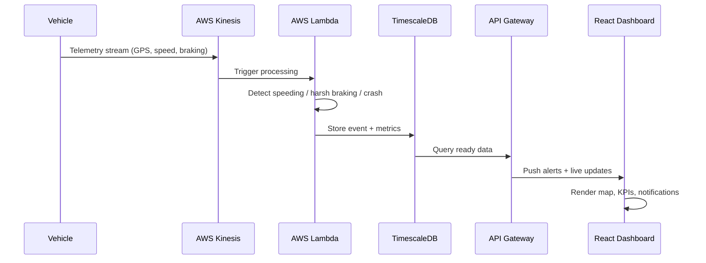

<div align="center">



<br/>


<br/><br/>

**Kilimanjaro StoneCap &nbsp;&middot;&nbsp; COS301 Capstone 2026 &nbsp;&middot;&nbsp; University of Pretoria**

<br/>

<p align="center">
  
  
  
</p>

<br/>

<a href="https://d25bouomowr0it.cloudfront.net/landing"></a>
<a href="https://github.com/COS301-SE-2026/Vehicle-Analytics-Platform/wiki"></a>
<a href="./docs/Demo3/VAPOR_User_Manual.pdf"></a>

<br/><br/>

[](https://github.com/COS301-SE-2026/Vehicle-Analytics-Platform/actions)
[](https://codecov.io/gh/COS301-SE-2026/Vehicle-Analytics-Platform)
[](https://stats.uptimerobot.com/3qOgv6HCr1)
[](https://github.com/COS301-SE-2026/Vehicle-Analytics-Platform/issues)
[](https://github.com/COS301-SE-2026/Vehicle-Analytics-Platform/issues?q=is%3Aissue+is%3Aclosed)
[](https://github.com/COS301-SE-2026/Vehicle-Analytics-Platform/commits)
[](https://nodejs.org/)
[](LICENSE)

<br/>

[](#project-description)
[](#data-flow)
[](#the-solution)
[](#use-cases)
[](#technology-stack)
[](#setup-guide)
[](#developer-guide)
[](#team-members)

</div>

---

**100+ vehicles** &nbsp;|&nbsp; **5-10 s** live map refresh &nbsp;|&nbsp; **11** features &nbsp;|&nbsp; **4** wow factors &nbsp;|&nbsp; **36** use cases &nbsp;|&nbsp; **3** user roles

---

<table width="100%">
<tr>
<td style="background: #0F172A; border-left: 4px solid #EA580C; border-radius: 10px; padding: 18px 24px;">
<span style="color: #F97316; font-size: 11px; font-weight: 700; letter-spacing: 3px; text-transform: uppercase;">01 · Overview</span>
<br/>
<span style="color: #FFFFFF; font-size: 26px; font-weight: 800;">Project Description</span>
</td>
</tr>
</table>

**Kilimanjaro StoneCap - V.A.P.O.R. (Vehicle Analytics, Processing and Operations in Real-time)**

V.A.P.O.R. is a real-time fleet analytics platform built for FuseIT. It ingests live telemetry data from 100+ vehicles via AWS Kinesis, processes it through serverless Lambda functions, and delivers actionable safety insights to fleet managers through role-based dashboards while detecting speeding, harsh braking, and crash events as they happen.

---

<table width="100%">
<tr>
<td style="background: #0F172A; border-left: 4px solid #EA580C; border-radius: 10px; padding: 18px 24px;">
<span style="color: #F97316; font-size: 11px; font-weight: 700; letter-spacing: 3px; text-transform: uppercase;">02 · Pipeline</span>
<br/>
<span style="color: #FFFFFF; font-size: 26px; font-weight: 800;">Data Flow</span>
</td>
</tr>
</table>

<details>
<summary><b>From telemetry to alert - click to expand the event lifecycle</b></summary>

<br/>



</details>

---

<table width="100%">
<tr>
<td style="background: #0F172A; border-left: 4px solid #EA580C; border-radius: 10px; padding: 18px 24px;">
<span style="color: #F97316; font-size: 11px; font-weight: 700; letter-spacing: 3px; text-transform: uppercase;">03 · Resources</span>
<br/>
<span style="color: #FFFFFF; font-size: 26px; font-weight: 800;">Links</span>
</td>
</tr>
</table>

| Resource                                  | Link |
| ----------------------------------------- | ---- |
| Live Web Application                      | [V.A.P.O.R. Live Demo](https://d25bouomowr0it.cloudfront.net/landing) |
| Developer Wiki                            | [Project Wiki](https://github.com/COS301-SE-2026/Vehicle-Analytics-Platform/wiki) |
| Software Requirements Specification (SRS) | [View srs.md](./docs/Demo3/srs/srs.md) |
| Brand Style Guide                         | [View Style Guide](https://d25bouomowr0it.cloudfront.net/) |
| Software Architecture Specification (SAS) | [View SAS.pdf](./docs/Demo3/SAS.pdf) |
| GitHub Project Board                      | [View Board](https://github.com/orgs/COS301-SE-2026/projects/49) |
| NFR Testing                               | [View README.md](./docs/Demo3/nfr-testing/README.md) |
| API Service Contracts                     | [View service-contracts.md](./docs/Demo3/api/service-contracts.md) |
| User Manual                               | [View User Manual.pdf](./docs/Demo3/VAPOR_User_Manual.pdf) |
| Team Email                                | kilimanjaro.capstone@gmail.com |

---

<table width="100%">
<tr>
<td style="background: #0F172A; border-left: 4px solid #EA580C; border-radius: 10px; padding: 18px 24px;">
<span style="color: #F97316; font-size: 11px; font-weight: 700; letter-spacing: 3px; text-transform: uppercase;">04 · Context</span>
<br/>
<span style="color: #FFFFFF; font-size: 26px; font-weight: 800;">The Problem</span>
</td>
</tr>
</table>

Modern fleet operators collect massive amounts of raw vehicle telemetry such as GPS coordinates, speed readings and braking events. The problem is how can we take these and turn them into actionable insights? Without real-time analysis, unsafe driver behaviour goes undetected and managers are left reacting to incidents after they happen rather than preventing them.

| No Real-Time Insights                                                  | Reactive Management                                                     | Underutilised Data                                                            |
| ---------------------------------------------------------------------- | ----------------------------------------------------------------------- | ----------------------------------------------------------------------------- |
| Raw GPS and speed data provide no actionable intelligence on their own | Safety issues are only addressed after an incident has already occurred | Continuous telemetry streams go unanalysed, wasting valuable operational data |

---

<table width="100%">
<tr>
<td style="background: #0F172A; border-left: 4px solid #EA580C; border-radius: 10px; padding: 18px 24px;">
<span style="color: #F97316; font-size: 11px; font-weight: 700; letter-spacing: 3px; text-transform: uppercase;">05 · Product</span>
<br/>
<span style="color: #FFFFFF; font-size: 26px; font-weight: 800;">The Solution</span>
</td>
</tr>
</table>

V.A.P.O.R. transforms raw vehicle telemetry into a proactive fleet management platform. By processing live data from AWS Kinesis streams, the platform delivers real-time driver safety scores, interactive fleet maps and analytics dashboards.

<details>
<summary><b>Features - click to expand the full feature list</b></summary>

<br/>

| Feature                            | Description                                                                                                                                   |
| ---------------------------------- | --------------------------------------------------------------------------------------------------------------------------------------------- |
| User Registration & Authentication | Self-registration with email verification, secure login via AWS Cognito, role-based redirect to Admin, Fleet Manager or Viewer dashboard      |
| Live Vehicle Map                   | Real-time interactive map showing 100+ vehicle positions updating every 5-10 seconds via Mapbox GL JS                                         |
| Fleet Dashboard & KPIs             | Live dashboard showing active vehicles, safety scores, alerts today and fleet performance metrics                                             |
| Trip History & Replay              | Completed trips with safety scores, event timelines, and animated route replay with speed visualisation                                       |
| Fuel Efficiency                    | Road-class-aware fuel consumption estimates per vehicle, with trend charts and fleet ranking                                                  |
| Geofencing                         | Named polygon zones with entry/exit alerts, automatic hotspot discovery, and per-zone event breakdowns                                        |
| Custom Alert Rules                 | Rule-based alerts for speeding, restricted hours, repeated unsafe events, safety score drops, and long trips, with 30-day backtesting preview |
| Fleet Analytics & Reports          | Daily and weekly safety trends, manager leaderboard, fleet performance reports, and weather and area risk reports                             |
| Predictive Risk Forecasting        | Machine learning forecast of tomorrow's high-risk vehicles, with explainable top reasons and closed-loop coaching outcomes                    |
| Anomaly Detection                  | Statistical outlier detection across driver behaviour, flagging unusual patterns before they become incidents                                 |
| Fleet Groups & Roles               | Administrator-managed groups with scoped access, audit logging, and coverage-gap notifications                                                |

</details>

<details>
<summary><b>Wow Factors - click to expand the full list</b></summary>

<br/>

**Predictive High-Risk Driving Forecast**  
Machine learning logistic regression trained on 90 days of fleet telemetry. Every prediction is explainable, with the top 3 contributing factors computed as the exact contribution of each feature. Vehicles flagged HIGH or CRITICAL get a coaching recommendation, and the system measures whether that coaching actually reduced risk 7 days later. It runs automatically at 3 AM and 4 AM via pg_cron. AUC 0.906 versus a persistence baseline of 0.882.

**Anomaly Detection**  
Statistical outlier detection across driver behaviour. Flags unusual patterns before they become incidents, using rolling window statistics on the telemetry stream.

**Weather and Area Risk Report**  
Correlates driving behaviour with real weather conditions. Compares wet and dry unsafe event rates per 100 km across areas, and marks each area and vehicle as Above fleet, Below fleet, or Insufficient data.

**Alert Rule Backtesting**  
Before a custom alert rule is saved, the system replays it against the last 30 days of telemetry and estimates how often it would have fired. This lets fleet managers tune thresholds before turning a rule on, instead of flooding the alert feed or catching nothing.

</details>

**Who it's for**

| Viewer                                                                           | Fleet Manager                                                                                                                                           | Administrator                                                                                                  |
| -------------------------------------------------------------------------------- | ------------------------------------------------------------------------------------------------------------------------------------------------------- | -------------------------------------------------------------------------------------------------------------- |
| Registers, signs in, tracks vehicles on the live map and accesses the help menu. | Monitors the fleet, reviews trips and zone alerts, builds custom alert rules, and runs analytics, reports and risk forecasts for their assigned groups. | Everything a Fleet Manager can do, plus user roles, account deactivation, fleet groups and vehicle assignment. |

---

<table width="100%">
<tr>
<td style="background: #0F172A; border-left: 4px solid #EA580C; border-radius: 10px; padding: 18px 24px;">
<span style="color: #F97316; font-size: 11px; font-weight: 700; letter-spacing: 3px; text-transform: uppercase;">06 · Scope</span>
<br/>
<span style="color: #FFFFFF; font-size: 26px; font-weight: 800;">Use Cases</span>
</td>
</tr>
</table>

V.A.P.O.R. has three primary user types: Viewer, Fleet Manager, and Administrator. Every use case below is mapped to its actor and user story.

<details>
<summary><b>Authentication and User Administration (UC01 to UC05)</b></summary>

| UC   | Use case                | Actor         | User story |
| ---- | ----------------------- | ------------- | ---------- |
| UC01 | Register Account        | Viewer        | US01       |
| UC02 | Log In                  | User          | US02       |
| UC03 | Log Out                 | User          | US02       |
| UC04 | Change User Role        | Administrator | US21       |
| UC05 | Deactivate User Account | Administrator | US21       |

</details>

<details>
<summary><b>Fleet Monitoring and Vehicle Profiles (UC06 to UC13)</b></summary>

| UC   | Use case                   | Actor          | User story |
| ---- | -------------------------- | -------------- | ---------- |
| UC06 | View Fleet Dashboard       | Fleet Operator | US03       |
| UC07 | Track Vehicles on Live Map | User           | US04       |
| UC08 | Access Help Menu           | User           | US05       |
| UC09 | View Notifications         | Fleet Operator | US19, US25 |
| UC10 | View Vehicle Profile       | Fleet Operator | US06       |
| UC11 | View Trip History          | Fleet Operator | US07       |
| UC12 | Replay Trip                | Fleet Operator | US08       |
| UC13 | View Fuel Efficiency       | Fleet Operator | US09       |

</details>

<details>
<summary><b>Geofencing (UC14 to UC17)</b></summary>

| UC   | Use case             | Actor          | User story |
| ---- | -------------------- | -------------- | ---------- |
| UC14 | Create Geofence Zone | Fleet Operator | US10       |
| UC15 | Edit Geofence Zone   | Fleet Operator | US10       |
| UC16 | Delete Geofence Zone | Fleet Operator | US10       |
| UC17 | Review Zone Alerts   | Fleet Operator | US11       |

</details>

<details>
<summary><b>Analytics and Reporting (UC18 to UC22)</b></summary>

| UC   | Use case                              | Actor          | User story |
| ---- | ------------------------------------- | -------------- | ---------- |
| UC18 | View Fleet Analytics                  | Fleet Manager  | US12       |
| UC19 | View Manager Leaderboard              | Fleet Manager  | US13       |
| UC20 | Generate Fleet Performance Report     | Fleet Operator | US14       |
| UC21 | Generate Weather and Area Risk Report | Fleet Operator | US15       |
| UC22 | View Vehicle Risk Forecast            | Fleet Operator | US16       |

</details>

<details>
<summary><b>Custom Alerts (UC23 to UC27)</b></summary>

| UC   | Use case                   | Actor         | User story |
| ---- | -------------------------- | ------------- | ---------- |
| UC23 | Create Alert Rule          | Fleet Manager | US17       |
| UC24 | Edit Alert Rule            | Fleet Manager | US17       |
| UC25 | Pause or Resume Alert Rule | Fleet Manager | US17       |
| UC26 | Delete Alert Rule          | Fleet Manager | US17       |
| UC27 | Review Triggered Alerts    | Fleet Manager | US18       |

</details>

<details>
<summary><b>Fleet Group Management (UC28 to UC36)</b></summary>

| UC   | Use case                         | Actor         | User story |
| ---- | -------------------------------- | ------------- | ---------- |
| UC28 | Create Fleet Group               | Administrator | US22       |
| UC29 | Edit Fleet Group                 | Administrator | US22       |
| UC30 | Delete Fleet Group               | Administrator | US22       |
| UC31 | Assign Fleet Manager             | Administrator | US23       |
| UC32 | Remove Fleet Manager             | Administrator | US23       |
| UC33 | Assign Vehicles to Group         | Administrator | US24       |
| UC34 | Unassign Vehicles from Group     | Administrator | US24       |
| UC35 | Transfer Vehicles Between Groups | Administrator | US24       |
| UC36 | View My Fleet Groups             | Fleet Manager | US20       |

</details>

**Key:** Fleet Operator is an abstract actor grouping Fleet Manager and Administrator for monitoring and analysis use cases they share.

---

<table width="100%">
<tr>
<td style="background: #0F172A; border-left: 4px solid #EA580C; border-radius: 10px; padding: 18px 24px;">
<span style="color: #F97316; font-size: 11px; font-weight: 700; letter-spacing: 3px; text-transform: uppercase;">07 · Stack</span>
<br/>
<span style="color: #FFFFFF; font-size: 26px; font-weight: 800;">Technology</span>
</td>
</tr>
</table>

### Frontend


### Data Pipeline (AWS)


### Database & Auth


### Infrastructure & DevOps


### Testing


---

<table width="100%">
<tr>
<td style="background: #0F172A; border-left: 4px solid #EA580C; border-radius: 10px; padding: 18px 24px;">
<span style="color: #F97316; font-size: 11px; font-weight: 700; letter-spacing: 3px; text-transform: uppercase;">08 · Getting Started</span>
<br/>
<span style="color: #FFFFFF; font-size: 26px; font-weight: 800;">Setup Guide</span>
</td>
</tr>
</table>

<details>
<summary><b>Click to expand the setup steps</b></summary>

### Prerequisites

- Node.js v20 or higher
- npm
- Git

### Step 1 - Clone the Repository

```bash
git clone https://github.com/COS301-SE-2026/Vehicle-Analytics-Platform.git
cd Vehicle-Analytics-Platform
```

### Step 2 - Install Frontend Dependencies

```bash
cd frontend
npm install
```

### Step 3 - Configure Environment Variables

```bash
cp .env.example .env
```

**Fill in `frontend/.env`:**

```env
VITE_API_URL=https://8cvbs5cpn9.execute-api.af-south-1.amazonaws.com/prod/api
VITE_MAPBOX_TOKEN=your_mapbox_token_here
```

**Fill in `backend/.env`:**

```env
DB_HOST=your_db_host
DB_PORT=6432
DB_NAME=fleet_analytics
DB_USER=your_db_user
DB_PASSWORD=your_db_password
COGNITO_USER_POOL_ID=your_cognito_user_pool_id
COGNITO_CLIENT_ID=your_cognito_client_id
AWS_REGION=af-south-1
```

> **Warning**  
> Never commit `.env` files or real credentials. Only the `.env.example` templates belong in version control.

### Step 4 - Run the Frontend

```bash
cd frontend
npm run dev
```

Visit [http://localhost:5173](http://localhost:5173)

### Step 5 - Run the Backend (Local Development Only)

```bash
cd backend
npm install
npm run dev
```

</details>

---

<table width="100%">
<tr>
<td style="background: #0F172A; border-left: 4px solid #EA580C; border-radius: 10px; padding: 18px 24px;">
<span style="color: #F97316; font-size: 11px; font-weight: 700; letter-spacing: 3px; text-transform: uppercase;">09 · Contributing</span>
<br/>
<span style="color: #FFFFFF; font-size: 26px; font-weight: 800;">Developer Guide</span>
</td>
</tr>
</table>

<details>
<summary><b>Click to expand the developer guide</b></summary>

### Git Strategy

| Branch    | Purpose                                                            |
| --------- | ------------------------------------------------------------------ |
| main      | Production, stable, release-ready code                             |
| develop   | Integration, latest development changes                            |
| feature/* | Feature branches, branch from develop, merge back to develop       |
| doc/*     | Documentation branches, branch from develop, merge back to develop |

All development work is done on `feature/*` branches. No direct commits to `main` or `develop`.

### Feature Workflow

```bash
# 1. Start from develop
git checkout develop
git pull origin develop

# 2. Create feature branch
git checkout -b feature/your-feature-name

# 3. Commit changes
git add .
git commit -m "feat: description of your feature"

# 4. Push to remote
git push origin feature/your-feature-name

# 5. Create Pull Request from feature/* to develop
```

### Running Tests

```bash
# Frontend tests
cd frontend && npm run test

# Backend tests
cd backend && npm run test
```

</details>

---

<table width="100%">
<tr>
<td style="background: #0F172A; border-left: 4px solid #EA580C; border-radius: 10px; padding: 18px 24px;">
<span style="color: #F97316; font-size: 11px; font-weight: 700; letter-spacing: 3px; text-transform: uppercase;">10 · Layout</span>
<br/>
<span style="color: #FFFFFF; font-size: 26px; font-weight: 800;">Project Structure</span>
</td>
</tr>
</table>

<details>
<summary><b>Click to expand the folder tree</b></summary>

```plaintext
.
|-- backend
|   |-- __mocks__
|   |-- __tests__
|   |-- src
|   |   |-- controllers
|   |   |-- db
|   |   |-- middleware
|   |   |-- routes
|   |   |-- services
|   |   `-- utils
|   `-- tests
|-- database
|   |-- __tests__
|   |-- migrations
|   `-- reverse-migrations
|-- docs
|   |-- Demo1
|   |-- Demo2
|   |-- Demo3
|   `-- Demo4
|-- frontend
|   |-- public
|   `-- src
|       |-- __tests__
|       |-- assets
|       |-- components
|       |-- hooks
|       |-- pages
|       |-- services
|       `-- store
`-- lambdas
    `-- kinesis_telemetry_ingestion
        `-- tests
```

</details>

---

<table width="100%">
<tr>
<td style="background: #0F172A; border-left: 4px solid #EA580C; border-radius: 10px; padding: 18px 24px;">
<span style="color: #F97316; font-size: 11px; font-weight: 700; letter-spacing: 3px; text-transform: uppercase;">11 · The Team</span>
<br/>
<span style="color: #FFFFFF; font-size: 26px; font-weight: 800;">Team Members</span>
</td>
</tr>
</table>

<table>
<tr>
<td align="center" width="200">
<br/>
<a href="https://github.com/u23770912"></a>
<br/><br/>
<b>Warona Moleboge</b>
<br/>
<sub>Cloud and Data Eng</sub>
<br/><br/>
<a href="https://www.linkedin.com/in/warona-moleboge-6855161b8"></a>
<a href="https://github.com/u23770912"></a>
<br/><br/>
</td>
<td align="center" width="200">
<br/>
<a href="https://github.com/ZiphoZ"></a>
<br/><br/>
<b>Ziphozinhle Maduna</b>
<br/>
<sub>Frontend and UX</sub>
<br/><br/>
<a href="https://www.linkedin.com/in/ziphozinhle-maduna"></a>
<a href="https://github.com/ZiphoZ"></a>
<br/><br/>
</td>
<td align="center" width="200">
<br/>
<a href="https://github.com/Kwanele-P"></a>
<br/><br/>
<b>Kwanele Phakathi</b>
<br/>
<sub>Frontend and Integration</sub>
<br/><br/>
<a href="https://www.linkedin.com/in/kwanele-phakathi-77028b231/"></a>
<a href="https://github.com/Kwanele-P"></a>
<br/><br/>
</td>
<td align="center" width="200">
<br/>
<a href="https://github.com/Boompie3"></a>
<br/><br/>
<b>Marchant Grootboom</b>
<br/>
<sub>Data Eng and Integration</sub>
<br/><br/>
<a href="https://www.linkedin.com/in/marchant-grootboom-246513234"></a>
<a href="https://github.com/Boompie3"></a>
<br/><br/>
</td>
<td align="center" width="200">
<br/>
<a href="https://github.com/Chriscoding19"></a>
<br/><br/>
<b>Christopher Adolph</b>
<br/>
<sub>Backend and Testing</sub>
<br/><br/>
<a href="https://www.linkedin.com/in/christopher-adolph-aa2069402/"></a>
<a href="https://github.com/Chriscoding19"></a>
<br/><br/>
</td>
</tr>
</table>

---

<table width="100%">
<tr>
<td style="background: #0F172A; border-left: 4px solid #EA580C; border-radius: 10px; padding: 18px 24px;">
<span style="color: #F97316; font-size: 11px; font-weight: 700; letter-spacing: 3px; text-transform: uppercase;">12 · Thanks</span>
<br/>
<span style="color: #FFFFFF; font-size: 26px; font-weight: 800;">Acknowledgements</span>
</td>
</tr>
</table>

We would like to thank our FuseIT mentors for their guidance, encouragement, and ongoing support throughout this project. Special thanks to Ayanda Juqu and Richard Lastrucci for their mentorship, feedback, and enthusiasm across every sprint, and to Edith Maphisa and Michael du Plessis for their continued input and for making this project possible.

We also thank our COS301 lecturer mentor Keith Homan and the COS301 staff for their ongoing guidance and reviews.

<div align="center">


<a href="#top">Back to top</a>

</div>
